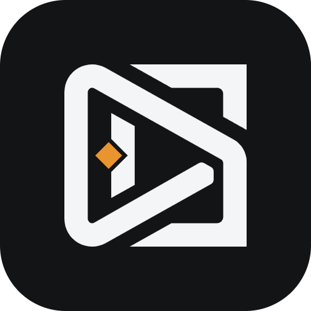
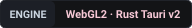

<div align="center">



# Storia Studio

**Estúdio de edição e animação de vídeo 2D & Retrô *local-first*, com motor WebGL2 a 60 FPS, 23 estilos de animação completos e direção ao vivo por IA via MCP.**

<p>
  <a href="../../README.md">Español</a> ·
  <a href="./README.en.md">English</a> ·
  <a href="./README.zh-CN.md">简体中文</a> ·
  <a href="./README.ru.md">Русский</a> ·
  <a href="./README.hi.md">हिन्दी</a> ·
  <strong>Português</strong>
</p>

<p>
  
  
  
  <a href="https://discord.gg/ahJM3hyFWr">
    
  </a>
</p>

<p>
  <a href="#download-e-início-rápido">Download</a> ·
  <a href="../README.md">Documentação</a> ·
  <a href="../releases-and-updates.md">Canais Estável e Nightly</a> ·
  <a href="../../SECURITY.md">Segurança</a> ·
  <a href="https://discord.gg/ahJM3hyFWr">Discord</a>
</p>

</div>

---

## O que é o Storia Studio?

**Storia Studio** é um editor de vídeo não linear (NLE) criado para produtores de conteúdo narrativo, educativo, Shorts/Reels e animação 2D ou retrô. Ele roda **100% localmente** no Windows, macOS e Linux, mantém projetos e credenciais criptografados na sua máquina e permite colaborar em tempo real com agentes de IA pelo padrão **Model Context Protocol (MCP)**.

## Principais destaques

| Recurso | O que está incluído |
|---|---|
| **Motor WebGL2 a 60 FPS** | Pré-visualização determinística em `9:16`, `16:9`, `1:1` e até **4K**, linha do tempo multipista magnética com formas de onda Web Audio, editor de código SVG ao vivo e Undo/Redo atômico. |
| **23 estilos de animação completos** | Troque de estilo para transformar personagens, cenários, sprites, formas, tipografia, legendas e shaders GPU: **3D Clay & Toon**, **Kurzgesagt Vector**, **Anime Cel**, **Retro PSX 1998**, **Paper Cutout**, **Pixel 16-bit**, **Rubber Hose 1930s**, **Noir**, **Mitologia** e Stickman A1–B8. |
| **Personagens 2D articulados** | Cinemática inversa (IK), 24 figurinos por papel, +26 penteados, poses, expressões e composição com sprites modulares. |
| **Legendas, Whisper e Voz TTS** | 36 presets estilo CapCut/Reels com destaque karaokê palavra por palavra, transcrição offline com **Whisper** e vozes TTS offline (**SAPI**, **Piper ONNX**, **Kokoro-82M**) ou na nuvem (**ElevenLabs**, **OpenAI**). |
| **Exportação 1:1 com FFmpeg** | Renderização paralela em GPU (`NVENC`) ou CPU (`libx264`), *motion blur* sub-quadro e masterização de áudio em 2 passadas a **`-16 LUFS`**. |
| **Bibliotecas gratuitas integradas** | Milhões de SVGs, ícones, músicas e SFX livres sem API Key (**Openverse**, **Iconify**, **Wikimedia Commons**, **Internet Archive**, **OpenMoji**) com `credits.txt` automático. |
| **IA ao vivo (MCP) e Zero-Trust** | Controle bidirecional (`stdio` e `/mcp` com **OAuth 2.1 + PKCE**), acesso móvel seguro por túnel (`ngrok` / `Cloudflare`), cofre `AES-256-GCM` e app nativo em **Rust (Tauri v2)**. |

## Download e início rápido

### Aplicativo Desktop (Windows · macOS · Linux)

Baixe o instalador para o seu sistema operacional na aba **Releases** deste repositório:

- **Estável (`v*`):** recomendado para produção diária (`.exe`, `.msi`, `.dmg`, `.AppImage`, `.deb`, `.rpm`).
- **Nightly (`nightly`):** compilação automática a cada commit na branch `master`. Alterne entre **Estável** e **Nightly** em **Configurações › Atualizações** para baixar, verificar o SHA-256 e reiniciar o app automaticamente em 1 clique.

Na primeira execução, um **assistente inicial (Onboarding)** de 6 passos configura pastas, bibliotecas gratuitas, modelos de voz e rede.

### Pelo código-fonte

```bash
pnpm install
pnpm build
pnpm dev
```

## Documentação

Toda a documentação técnica e guias completos estão na pasta [`docs/`](../README.md):

- **[Primeiros passos e instalação](../getting-started.md)** — Requisitos, Onboarding, comandos de desenvolvimento e variáveis de ambiente.
- **[Arquitetura e motor criativo](../architecture.md)** — Estrutura do monorepo, 23 estilos de animação, rigs e pipeline FFmpeg.
- **[MCP para IAs e acesso remoto](../mcp-and-remote.md)** — Configuração `stdio` e HTTP `/mcp`, OAuth 2.1, túneis e modelo Zero-Trust.
- **[Releases, canais e atualizações](../releases-and-updates.md)** — Atualizador automático Estável/Nightly e build Desktop em Rust.
- **[Política de segurança](../../SECURITY.md)** — Cofre criptografado, isolamento local e relato responsável.

## Comunidade

Entre na comunidade oficial do **Discord** para acompanhar novidades, atualizações Estável/Nightly, suporte e futuras integrações do Storia Studio:

<p>
  <a href="https://discord.gg/ahJM3hyFWr">
    
  </a>
</p>

## Licença

Copyright © 2026 Mairon Mayorga. Todos os direitos reservados.  
Consulte [LICENSE.md](../../LICENSE.md) para os termos completos da licença.
