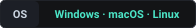

<div align="center">


# Storia Studio

**Локальная студия видеомонтажа и 2D/ретро-анимации (*local-first*) на движке WebGL2 (60 FPS) с 23 полноценными стилями анимации и живым управлением через ИИ (MCP).**

<p>
  <a href="../../README.md">Español</a> ·
  <a href="./README.en.md">English</a> ·
  <a href="./README.zh-CN.md">简体中文</a> ·
  <strong>Русский</strong> ·
  <a href="./README.hi.md">हिन्दी</a> ·
  <a href="./README.pt.md">Português</a>
</p>

<p>
  
  
  
  <a href="https://discord.gg/ahJM3hyFWr">
    
  </a>
</p>

<p>
  <a href="#загрузка-и-быстрый-старт">Скачать</a> ·
  <a href="../README.md">Документация</a> ·
  <a href="../releases-and-updates.md">Каналы Stable и Nightly</a> ·
  <a href="../../SECURITY.md">Безопасность</a> ·
  <a href="https://discord.gg/ahJM3hyFWr">Discord</a>
</p>

</div>

---

## Что такое Storia Studio?

**Storia Studio** — это локальный нелинейный видеоредактор (NLE) для авторов сюжетных, образовательных роликов, Shorts/Reels и 2D/ретро-анимации. Приложение работает **на 100% локально** на Windows, macOS и Linux, хранит проекты и ключи в зашифрованном виде на вашем компьютере и позволяет ИИ-агентам работать с таймлайном в реальном времени через **Model Context Protocol (MCP)**.

## Ключевые возможности

| Возможность | Что входит |
|---|---|
| **Движок WebGL2 (60 FPS)** | Детерминированный предпросмотр в `9:16`, `16:9`, `1:1` и до **4K**, магнитный многодорожечный таймлайн с формами волн Web Audio, живой редактор SVG-кода и атомарная история Undo/Redo. |
| **23 комплексных стиля анимации** | Переключение стиля преобразует персонажей, фоны, спрайты, фигуры, типографику, субтитры и GPU-шейдеры: **3D Clay & Toon**, **Kurzgesagt Vector**, **Anime Cel**, **Retro PSX 1998**, **Paper Cutout**, **Pixel 16-bit**, **Rubber Hose 1930s**, **Noir**, **Мифология** и Stickman A1–B8. |
| **Артикулированные 2D-риги** | Инверсная кинематика (IK), 24 комплекта одежды по ролям, более 26 причёсок, позы, эмоции и поддержка модульных спрайтов. |
| **Субтитры, Whisper и TTS** | 36 пресетов в стиле CapCut/Reels с пословной подсветкой караоке, офлайн-транскрибация **Whisper** и синтез речи (**SAPI**, **Piper ONNX**, **Kokoro-82M**, **ElevenLabs**, **OpenAI**). |
| **Экспорт 1:1 через FFmpeg** | Параллельный рендеринг на GPU (`NVENC`) или CPU (`libx264`), субкадровое размытие движения и двухпроходная нормализация громкости **`-16 LUFS`**. |
| **Встроенные бесплатные библиотеки** | Миллионы SVG, иконок, музыки и SFX без API-ключей (**Openverse**, **Iconify**, **Wikimedia Commons**, **Internet Archive**, **OpenMoji**) с автоматическим `credits.txt`. |
| **Живой ИИ (MCP) и Zero-Trust** | Двусторонний `stdio` и Streamable HTTP `/mcp` с **OAuth 2.1 + PKCE**, безопасный мобильный доступ через туннель (`ngrok` / `Cloudflare`), хранилище `AES-256-GCM` и нативное приложение на **Rust (Tauri v2)**. |

## Загрузка и быстрый старт

### Десктопное приложение (Windows · macOS · Linux)

Скачайте установщик для вашей ОС на вкладке **Releases** этого репозитория:

- **Stable (`v*`):** стабильные релизы для ежедневной работы (`.exe`, `.msi`, `.dmg`, `.AppImage`, `.deb`, `.rpm`).
- **Nightly (`nightly`):** автоматическая сборка при каждом коммите в `master`. Вы можете переключаться между **Stable** и **Nightly** в **Настройки › Обновления** для установки в 1 клик с проверкой SHA-256 и автоматическим перезапуском.

При первом запуске открывается пошаговый **мастер настройки (Onboarding)** для выбора папок, бесплатных библиотек, голосовых моделей и сетевых параметров.

### Запуск из исходного кода

```bash
pnpm install
pnpm build
pnpm dev
```

## Документация

Подробные руководства находятся в папке [`docs/`](../README.md):

- **[Начало работы и установка](../getting-started.md)** — Требования, Onboarding, команды разработки и переменные окружения.
- **[Архитектура и движок](../architecture.md)** — Структура монорепозитория, 23 стиля анимации, риги и экспорт FFmpeg.
- **[MCP для ИИ и удалённый доступ](../mcp-and-remote.md)** — Настройка `stdio` и HTTP `/mcp`, OAuth 2.1, туннели и модель Zero-Trust.
- **[Релизы, каналы и обновления](../releases-and-updates.md)** — Автообновление Stable/Nightly и локальная сборка на Rust.
- **[Политика безопасности](../../SECURITY.md)** — Шифрование, изоляция локального администрирования и сообщения об уязвимостях.

## Сообщество

Присоединяйтесь к официальному серверу **Discord**, чтобы следить за новостями, обновлениями Stable/Nightly и будущими интеграциями Storia Studio:

<p>
  <a href="https://discord.gg/ahJM3hyFWr">
    
  </a>
</p>

## Лицензия

Copyright © 2026 Mairon Mayorga. Все права защищены.  
Полный текст лицензии доступен в [LICENSE.md](../../LICENSE.md).
