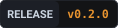

<div align="center">


# Storia Studio

**本地优先（Local-first）的 2D 与复古风格视频剪辑及动画工作室：60 FPS WebGL2 渲染引擎、23 种全管线动画风格，以及基于 MCP 的实时 AI 协同创作。**

<p>
  <a href="../../README.md">Español</a> ·
  <a href="./README.en.md">English</a> ·
  <strong>简体中文</strong> ·
  <a href="./README.ru.md">Русский</a> ·
  <a href="./README.hi.md">हिन्दी</a> ·
  <a href="./README.pt.md">Português</a>
</p>

<p>
  
  
  
  <a href="https://discord.gg/ahJM3hyFWr">
    
  </a>
</p>

<p>
  <a href="#下载与快速开始">下载</a> ·
  <a href="../README.md">文档</a> ·
  <a href="../releases-and-updates.md">Stable 与 Nightly 通道</a> ·
  <a href="../../SECURITY.md">安全策略</a> ·
  <a href="https://discord.gg/ahJM3hyFWr">Discord</a>
</p>

</div>

---

## 什么是 Storia Studio？

**Storia Studio** 是一款专为叙事视频、科普教育、短视频（Shorts/Reels）以及 2D/复古动画创作者打造的本地非线性视频编辑器（NLE）。软件在 Windows、macOS 和 Linux 上**完全本地运行**，将项目文件与密钥加密保存在本地，并通过 **Model Context Protocol (MCP)** 让 AI 智能体与你实时协同编辑时间线。

## 核心亮点

| 功能模块 | 特性说明 |
|---|---|
| **60 FPS WebGL2 渲染引擎** | 支持 `9:16`、`16:9`、`1:1` 及最高 **4K** 确定性预览，配备磁吸多轨时间线、Web Audio 波形、实时 SVG 代码编辑器以及原子级撤销/重做。 |
| **23 种全管线动画风格** | 一键切换即可同步重构角色、场景、精灵、矢量图形、字幕和 GPU 着色器：**3D 黏土卡通**、**Kurzgesagt 科普矢量**、**日系赛璐璐**、**1998 PSX 复古 3D**、**剪纸拼贴**、**16-bit 像素剧场**、**1930s 橡皮管**、**黑色电影**、**希腊神话**及 Stickman A1–B8。 |
| **2D 骨骼角色系统** | 反向动力学（IK）、24 种职业服饰、26+ 发型、姿态与表情平滑过渡，并支持自定义模块化精灵。 |
| **字幕、Whisper 与语音 TTS** | 内置 36 套动态卡拉 OK 字幕预设、离线 **Whisper** 语音转字幕，以及离线/云端配音（**SAPI**、**Piper ONNX**、**Kokoro-82M**、**ElevenLabs**、**OpenAI**）。 |
| **1:1 FFmpeg 专业导出** | 多进程并行渲染、GPU（`NVENC`）或 CPU（`libx264`）编码、子帧动态模糊，以及两遍扫描 **`-16 LUFS`** 响度母带处理。 |
| **内置免费素材库** | 无需 API Key 即可使用数百万 CC0/CC-BY 矢量、图标、音乐与音效（**Openverse**、**Iconify**、**Wikimedia Commons**、**Internet Archive**、**OpenMoji**），并自动生成 `credits.txt` 版权署名。 |
| **实时 AI (MCP) 与零信任安全** | 支持 `stdio` 与 Streamable HTTP `/mcp`（**OAuth 2.1 + PKCE**）、安全移动端隧道（`ngrok` / `Cloudflare`）、`AES-256-GCM` 密钥保险库及原生 **Rust (Tauri v2)** 桌面应用。 |

## 下载与快速开始

### 桌面客户端（Windows · macOS · Linux）

请前往本仓库的 **Releases** 页面下载适用于你系统的原生安装包：

- **Stable（稳定版 `v*`）：** 适合日常创作与稳定生产（`.exe`、`.msi`、`.dmg`、`.AppImage`、`.deb`、`.rpm`）。
- **Nightly（每日构建 `nightly`）：** `master` 分支每次提交自动构建。可在 **设置 › 更新** 中自由切换 **Stable** 或 **Nightly** 通道，支持 SHA-256 校验后一键更新并自动重启。

首次启动时，6 步**引导向导（Onboarding）**将帮助你快速完成目录、免费素材库、语音模型和网络设置。

### 从源码运行

```bash
pnpm install
pnpm build
pnpm dev
```

## 文档中心

完整的安装与技术文档位于 [`docs/`](../README.md)：

- **[快速入门与安装](../getting-started.md)** — 环境要求、首次引导、开发命令与环境变量。
- **[架构与创作引擎](../architecture.md)** — Monorepo 结构、23 种动画风格、骨骼系统与 FFmpeg 导出管线。
- **[MCP 与远程访问](../mcp-and-remote.md)** — `stdio` / HTTP `/mcp` 配置、OAuth 2.1、隧道与零信任安全。
- **[发布通道与自动更新](../releases-and-updates.md)** — Stable / Nightly 机制与 Rust 桌面端构建指南。
- **[安全策略](../../SECURITY.md)** — 加密保险库、本地管理隔离与漏洞反馈流程。

## 社区

欢迎加入 **Storia Studio 官方 Discord 社区**，获取最新动态、Stable/Nightly 更新通知、使用交流以及未来集成规划：

<p>
  <a href="https://discord.gg/ahJM3hyFWr">
    
  </a>
</p>

## 许可证

Copyright © 2026 Mairon Mayorga. 保留所有权利。  
完整许可条款请参阅 [LICENSE.md](../../LICENSE.md)。
